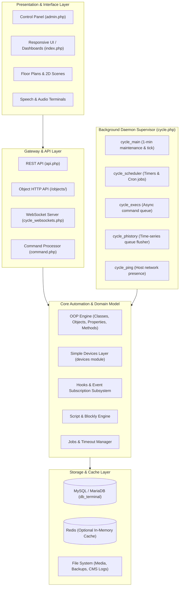

# MajorDoMo (Major Domestic Module)

<p align="center">
  
</p>

<p align="center">
  <strong>An open-source, multi-protocol, self-hosted smart home automation platform.</strong>
</p>

<p align="center">
  <a href="https://github.com/sergejey/majordomo/blob/master/LICENSE"></a>
  <a href="https://www.php.net/"></a>
  <a href="https://mariadb.org/"></a>
  <a href="https://github.com/sergejey/majordomo"></a>
  <a href="https://forum.majordomohome.com/"></a>
</p>

---

## Table of Contents

- [Overview](#overview)
- [How MajorDoMo Helps You](#how-majordomo-helps-you)
- [Key Features](#key-features)
- [System Architecture](#system-architecture)
- [Hardware & Protocols](#hardware--protocols)
- [Getting Started](#getting-started)
  - [Prerequisites](#prerequisites)
  - [Linux Installation](#linux-installation)
  - [Windows Installation](#windows-installation)
  - [Background Cycles Setup](#background-cycles-setup)
- [REST API & Remote Control](#rest-api--remote-control)
- [Developer Extensibility](#developer-extensibility)
- [Marketplace & Addons](#marketplace--addons)
- [Community & Ecosystem](#community--ecosystem)
- [Contributing](#contributing)
- [License](#license)

---

## Overview

**MajorDoMo** (*Major Domestic Module*) is a mature, comprehensive, open-source smart home automation platform designed to run in diverse, multi-protocol, and heterogeneous hardware environments. Built on an extensible PHP & MySQL foundation, it gives you complete data sovereignty and local execution without forced cloud subscriptions or vendor lock-in.

Whether you are automating a single room with DIY microcontrollers or orchestrating an entire estate with commercial IoT hardware, MajorDoMo brings all devices, protocols, sensor histories, and automation logic together into a unified, user-friendly interface accessible from any browser, tablet, or smartphone.

---

## How MajorDoMo Helps You

MajorDoMo is engineered to solve the most common smart home challenges:

- **Unified Control Across Incompatible Brands**: Unify devices from Xiaomi, Sonoff, Tuya, Apple HomeKit, MQTT devices, Zigbee/Z-Wave networks, 1-Wire sensors, and custom Arduino/ESP8266/ESP32 modules in one dashboard.
- **100% Privacy & Local Execution**: Your automations, sensor logs, camera streams, and personal routines run locally on your hardware. If your internet goes down, your home continues to operate without interruption.
- **Flexible Automation for Any Skill Level**:
  - *Beginners*: Build logic using drag-and-drop **Blockly** visual blocks and link devices with pre-built rules.
  - *Power Users*: Write powerful PHP scripts, timed jobs, event hooks, and regex-powered voice commands.
- **Interactive Dashboards & 2D/3D Floor Plans**: Design dynamic floor plans and custom graphical scenes where room lights, climate, and locks react to state changes in real time.
- **Voice Assistant & Speech Synthesis (TTS)**: Broadcast voice notifications, announcements, and alarms across distributed multi-room terminals (browsers, media players, smart speakers, Raspberry Pi units).
- **Long-Term Data Logging & Analytics**: Track temperature, power consumption, humidity, and device runtimes with automatic time-series logging and built-in charts.

---

## Key Features

| Capability | Description |
|---|---|
| **Object-Oriented Domain Model** | Hierarchical classes, objects, properties, and methods. Encapsulate behaviors (e.g. `Relay.turnOn`, `Sensor.value`) with inheritance and lifecycle triggers. |
| **Simple Devices Abstraction** | Out-of-the-box standardized device classes (`Light`, `Dimmer`, `RGB`, `Thermostat`, `MotionSensor`, `DoorSensor`, `Camera`, `Vacuum`, etc.) with zero-code setup. |
| **Real-Time WebSockets** | Native background WebSocket server providing instant bi-directional updates between physical hardware and browser dashboards. |
| **Visual Scene & Layout Editor** | Create rich interactive UI dashboards, 2D floor plans, widgets, and multi-view layouts customized for wall-mounted tablets and mobile devices. |
| **Natural Language & Voice Commands** | Pattern-matching engine that parses conversational voice/text phrases into automated actions and contextual responses. |
| **Apple HomeKit Integration** | Built-in Homebridge synchronization allows controlling your MajorDoMo devices seamlessly via Apple Home and Siri. |
| **Multi-Terminal Audio Management** | Route system notifications, speech (TTS), and media playback to specific rooms and network-connected terminals. |
| **In-Panel Addon Market** | Expand system capabilities with hundreds of one-click installable plugins, hardware drivers, themes, and community applications. |

---

## System Architecture

MajorDoMo leverages a modular multi-tier architecture designed for continuous 24/7 background operation:



---

## Hardware & Protocols

MajorDoMo provides broad hardware interoperability:

- **Protocols**: MQTT, HTTP/REST, WebSockets, SNMP, Modbus, 1-Wire (OWFS), UPnP/DLNA, Bluetooth (presence & RSSI), TCP/UDP raw sockets.
- **Smart Ecosystems**: Apple HomeKit (Homebridge), Zigbee (zigbee2mqtt), Z-Wave, Tuya, Xiaomi / Aqara, Sonoff (eWeLink / Tasmota / ESPHome), Shelly, Broadlink.
- **DIY Microcontrollers**: Arduino, ESP8266, ESP32, Raspberry Pi GPIO.
- **Media & Audio**: MPD, VLC, Foobar2000, Kodi, Google Cast, DLNA renderers.
- **Cloud & Remote Access**: Optional end-to-end integration with the [MajorDoMo Connect](https://connect.majordomohome.com/) cloud service for secure remote access without a public IP.

---

## Getting Started

### Prerequisites

- **Web Server**: Apache (with `mod_rewrite` enabled) or Nginx (sample config provided in `nginx.conf.sample`).
- **PHP**: Version 7.4 through 8.x with extensions:
  - `mysqli`, `curl`, `mbstring`, `gd`, `sockets`, `xml`
- **Database**: MariaDB 10.3+ or MySQL 5.7+.
- **Operating System**: Linux (Ubuntu, Debian, Raspberry Pi OS, Alpine) or Windows.

---

### Linux Installation

1. **Clone the repository**:
   ```bash
   cd /var/www
   git clone https://github.com/sergejey/majordomo.git html
   cd html
   ```

2. **Set up directory permissions**:
   Run the included permission helper script:
   ```bash
   chmod +x ./install-linux.sh
   sudo ./install-linux.sh
   sudo usermod -a -G audio www-data
   ```

3. **Initialize the database**:
   Create a database and import the default schema:
   ```bash
   mysql -u root -p -e "CREATE DATABASE db_terminal CHARACTER SET utf8mb4 COLLATE utf8mb4_unicode_ci;"
   mysql -u root -p db_terminal < db_terminal.sql
   ```

4. **Configure database credentials**:
   Copy the sample configuration file and edit your settings:
   ```bash
   cp config.php.sample config.php
   nano config.php
   ```
   Configure your database parameters:
   ```php
   Define('DB_HOST', 'localhost');
   Define('DB_NAME', 'db_terminal');
   Define('DB_USER', 'your_db_user');
   Define('DB_PASSWORD', 'your_db_password');
   ```

5. **Access the Web Interface**:
   Open your browser and navigate to:
   - **Frontend UI**: `http://<your-server-ip>/`
   - **Admin Control Panel**: `http://<your-server-ip>/admin.php`

---

### Windows Installation

1. Deploy using a preconfigured WAMP/OpenServer environment or manual Apache/PHP/MySQL setup.
2. Clone or extract this repository into your web root directory (e.g. `C:\Server\htdocs\`).
3. Import `db_terminal.sql` into MySQL/MariaDB.
4. Copy `config.php.sample` to `config.php` and set the database connection details.
5. Open `http://localhost/admin.php` in your browser.

---

### Background Cycles Setup

MajorDoMo relies on continuous background worker daemons orchestrated by `cycle.php` to process scheduled timers, ping checks, asynchronous tasks, and WebSocket connections.

#### Running manually:
```bash
php /var/www/html/cycle.php
```

#### Running as a systemd service (Recommended for Linux):
Create a systemd unit file `/etc/systemd/system/majordomo.service`:

```ini
[Unit]
Description=MajorDoMo Background Daemon Orchestrator
After=network.target mysql.service

[Service]
Type=simple
User=www-data
WorkingDirectory=/var/www/html
ExecStart=/usr/bin/php /var/www/html/cycle.php
Restart=always
RestartSec=10

[Install]
WantedBy=multi-user.target
```

Enable and start the service:
```bash
sudo systemctl daemon-reload
sudo systemctl enable majordomo.service
sudo systemctl start majordomo.service
```

---

## REST API & Remote Control

MajorDoMo includes a flexible RESTful JSON API (`api.php`) for third-party integrations, mobile applications, and external microservices.

### Common API Endpoints

| Endpoint | Method | Description | Example |
|---|---|---|---|
| `/api/devices` | `GET` | List all Simple Devices and statuses | `curl http://localhost/api/devices` |
| `/api/devices/{id}` | `GET` / `POST` | Retrieve or control a specific device | `curl -X POST http://localhost/api/devices/12 -d "status=1"` |
| `/api/data/{object.property}` | `GET` / `POST` | Get or update any object property | `curl http://localhost/api/data/Relay01.status` |
| `/api/history/{object.property}` | `GET` | Fetch historical time-series data | `curl http://localhost/api/history/Sensor01.value` |
| `/api/method/{object.method}` | `POST` | Execute an object method | `curl -X POST http://localhost/api/method/Relay01.turnOn` |
| `/api/script/{script_name}` | `POST` | Run an automation script | `curl -X POST http://localhost/api/script/NightMode` |
| `/api/events/{event_name}` | `POST` | Trigger a system event | `curl -X POST http://localhost/api/events/MotionDetected` |

### Direct Object HTTP Endpoint

You can also read and write values directly via the object endpoint:
- **Set value**: `http://localhost/objects/?object=Relay01&op=set&p=status&v=1`
- **Get value**: `http://localhost/objects/?object=Relay01&op=get&p=status`
- **Call method**: `http://localhost/objects/?object=Relay01&op=m&m=switch`

---

## Developer Extensibility

MajorDoMo is designed around standard OOP design patterns with comprehensive developer utilities.

### Core Helper Functions

Always reuse existing core framework methods in your custom modules and scripts:

```php
// Object & Property Manipulation
$val = getGlobal('SensorTemperature.value');
setGlobal('LivingRoomLight.status', 1);
callMethod('LivingRoomLight.turnOn');

// Timers & Scheduling
setTimeOut('HallwayLightOff', 'callMethod("HallwayLight.turnOff");', 120);
clearTimeOut('HallwayLightOff');
addScheduledJob('DailyMorningRoutine', 'runScript("MorningScene");', strtotime('tomorrow 07:00'));

// Voice & Speech (TTS)
say('Welcome home, master!', 1);
sayTo('Front door opened', 2, 'KitchenTerminal');

// Database Operations
$rows = SQLSelect("SELECT * FROM devices WHERE TYPE = 'motion'");
$device = SQLSelectOne("SELECT * FROM devices WHERE ID = 5");
```

> [!NOTE]
> For internal architectural reference and complete module guidelines, see [`PROJECT_MAP.md`](PROJECT_MAP.md). If contributing code with AI agents or tools, review [`AGENTS.md`](AGENTS.md).

---

## Marketplace & Addons

MajorDoMo features an integrated Addon Marketplace:
1. Open the **Control Panel** (`admin.php`).
2. Navigate to **System** &rarr; **Market**.
3. Browse, search, and install hardware drivers, modules, themes, and integrations with a single click.
4. Update modules directly through the panel's update manager.

---

## Community & Ecosystem

Join the supportive, global MajorDoMo community to share projects, get help, and discover integrations:

- 🌐 **Official Website**: [majordomohome.com](https://majordomohome.com/?utm_source=github&utm_medium=link&utm_campaign=main_page)
- 💬 **Community Forums**: [MajorDoMo Community Forum](https://forum.majordomohome.com/?utm_source=github&utm_medium=link&utm_campaign=forum)
- ☁️ **MajorDoMo Connect Cloud**: [connect.majordomohome.com](https://connect.majordomohome.com/)

---

## Contributing

We welcome contributions of all kinds! Whether you want to fix a bug, integrate new hardware, improve translations, or write documentation:

1. Fork the repository on GitHub.
2. Create a feature branch (`git checkout -b feature/my-new-feature`).
3. Commit your changes following existing code conventions (`git commit -m 'Add support for XYZ device'`).
4. Push to your branch (`git push origin feature/my-new-feature`).
5. Open a Pull Request.

Feel free to connect with the team via the [forum](https://forum.majordomohome.com/) or direct inquiries at `ip@mdmi.by`.

---

## License

This project is licensed under the **MIT License** - see the [LICENSE](LICENSE) file for details.
